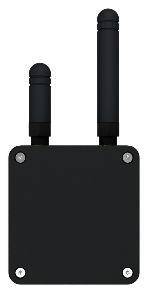

<div align="center" markdown="1">



# kode-fck-sdk

**The SDK for the F\*CK module of the Kode Dot: Wi-Fi, Bluetooth, 2.4 GHz, sub-GHz and GNSS from an app, in C**

[](https://github.com/espressif/esp-idf)


[Documentation](https://docs.kode.diy/modules/fck) ·
[Quick start](#quick-start) ·
[Examples](#examples) ·
[kode-sdk](https://github.com/kodediy/kode-sdk)

</div>

---

The F\*CK (KDFCK001) is a radio module for the **Kode Dot**. It plugs into the expansion header and carries an ESP32-C5 (Wi-Fi and Bluetooth), an nRF54L15 (2.4 GHz), a CC1101 (sub-GHz) and a GNSS receiver. This SDK sits next to [kode-sdk](https://github.com/kodediy/kode-sdk): an app adds one dependency and calls `fck_wifi_scan()`, `fck_subghz_spectrum()` or `fck_gnss_read()`, and does not need to know the pins or the protocols of the module.

- **One owner for the module.** One Active Object finds the module, sets it up and holds it; your code asks it and never touches a chip. The module can be plugged in or pulled out at any time.
- **Two layers, as in kode-sdk.** `fck.h` has calls that wait, for `app_main()` and your tasks: each answers `true` or `false`, and `fck_error()` says why. `fck_sys.h` has calls that never wait, for an Active Object of your own.
- **Nothing transmits by itself.** A call that transmits says TRANSMITS in its header comment, and stays inside the module's radio limits: the sub-GHz bands, power and air time in the SDK, and the C5's and the nRF's in their firmwares. No call and no option lifts them.

```c
#include "kode.h"
#include "fck.h"

void app_main(void)
{
    fck_firmware_t fw;

    kode_init();                                  /* start the board */
    fck_begin();                                  /* take the header, look for the module */
    if (fck_wait_present(10000) && fck_firmware(FCK_C5, &fw)) {
        kode_print("the C5 runs %s", fw.fw);      /* nothing here transmits */
    } else {
        kode_print("no module: %s", fck_error());
    }
    kode_exit();                                  /* back to kodeOS */
}
```

## Quick start

You need a Kode Dot running kodeOS, an F\*CK module on its expansion header and [ESP-IDF v6.1](https://docs.espressif.com/projects/esp-idf/en/v6.1/esp32p4/get-started/).

```bash
. <path-to-esp-idf>/export.sh
idf.py -C examples/module build
idf.py -C examples/module -p PORT flash
```

The first build prints one CMake error while it fetches the board settings, `kbsp: the partition table has no apps region (data, 0x40), so this app has nowhere to be installed`, and goes on by itself. `flash` writes the app to the board's mailbox; kodeOS installs it and starts it. The log says what the module is and what each of its chips runs. Pull the module out and the log says so. A short press of the bottom button goes back to kodeOS.

To start an app of your own, copy the example closest to it.

## Examples

| | |
|---|---|
| `module` | the module found on the header, and what each chip runs. Run it first |
| `wifi` | how busy each Wi-Fi channel is, and the Bluetooth devices around |
| `radio` | the level of the 2.4 GHz band, and the frames heard on it |
| `gnss` | a fix every second |
| `subghz` | the CC1101: a level, the band, a remote found, captured and decoded. **Transmits** only when asked from the console, after `fck_arm 1` |
| `wardriving` | Wi-Fi, Bluetooth and GNSS into a WiGLE file on the microSD card. **Transmits** after its top button: the Wi-Fi scan sends probe requests |
| `console_actions` | the module on kodeOS's console |

`module`, `subghz` and `wardriving` are tasks (`fck.h`); the other four are Active Objects (`fck_sys.h`). No example records or transmits without a keypress or a typed row.

## Use it in your project

```yaml
# main/idf_component.yml
dependencies:
  kodediy/kode:
    git: https://github.com/kodediy/kode-sdk.git
    path: components/kode
    version: v0.1.5
  kodediy/fck:                       # or kodediy/fck_sys, for an app with Active Objects
    git: https://github.com/kodediy/kode-fck-sdk.git
    path: components/fck             # or components/fck_sys
    version: v0.1.0
```

Add `fck` (or `fck_sys`) to your component's `REQUIRES`. Copy `CMakeLists.txt` and `sdkconfig.defaults` from an example: they fetch the Dot's settings from kode-sdk, and they set `CONFIG_KODEOS_RADIO=y`, which lets the SDK switch the module's supply.

## Not run on a module yet

This release passes its host tests and builds for the ESP32-P4. On a module, the examples `module` and `console_actions` have run with it; the other examples, the sub-GHz sends and the 2.4 GHz radio have not yet, so try them first with nothing that matters on the air.

## Documentation

Everything else is at **[docs.kode.diy/modules/fck](https://docs.kode.diy/modules/fck)**. In this repository: [the overview](docs/overview.md) (what the SDK drives, how it works, what surprises, the options, the console, what it costs an app and the layout of the tree), [the `.ksub` file format](docs/ksub-format.md), [the module's firmware](firmware/README.md) and [a firmware of your own for the C5](c5/README.md). The two headers, `fck.h` and `fck_sys.h`, are the contract. Each component and each example also has a short README.

## Contributing

Bugs, ideas and pull requests are welcome. Read [CONTRIBUTING.md](CONTRIBUTING.md) first; the checks a change must pass are `tools/host_tests.sh`, `tools/check_layers.sh` and `idf.py -C tests/target build`, run on your machine.

## Licence

[GPL-3.0-or-later](LICENSE), as kode-sdk. [NOTICE.md](NOTICE.md) says which licence applies where.
